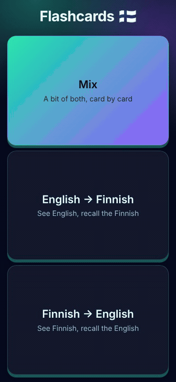
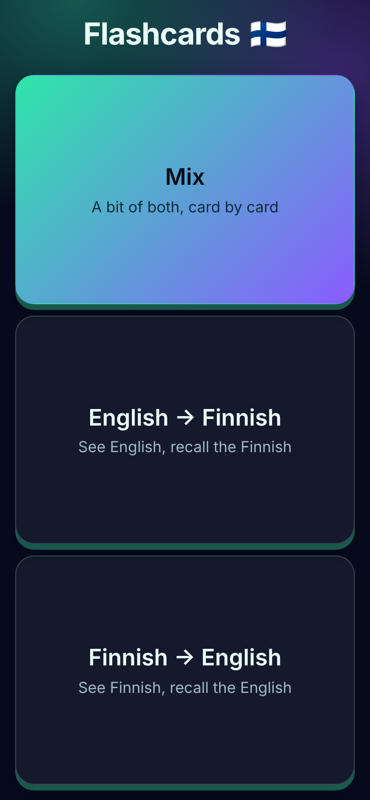
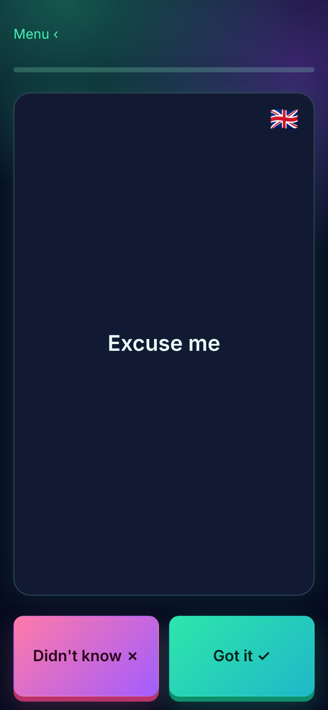
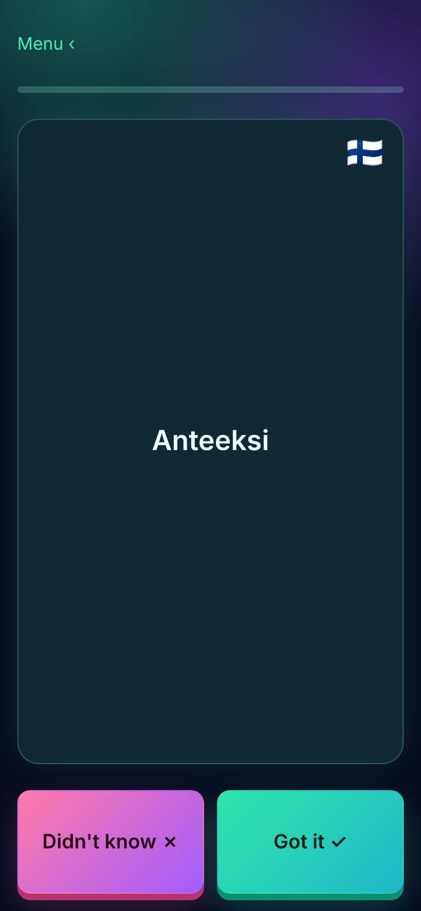
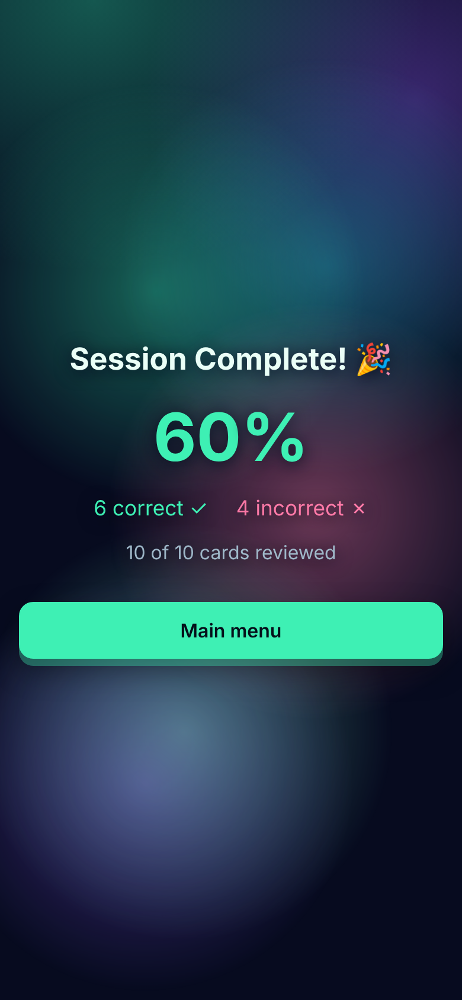

# Flashcards 🇫🇮

**Learn Finnish one flip at a time.**

---

### Tap. Flip. Know it?

  
  
  
  

- 🔀 **Three modes:** English → Finnish, Finnish → English, or mix it up
- 🎲 **Shuffled every session**, so no two runs are the same
- 📊 **Instant score** when you finish the deck
- 📱 **Built for your phone** and installable to your home screen

---

The app's source is private. This repo is just the showcase.
